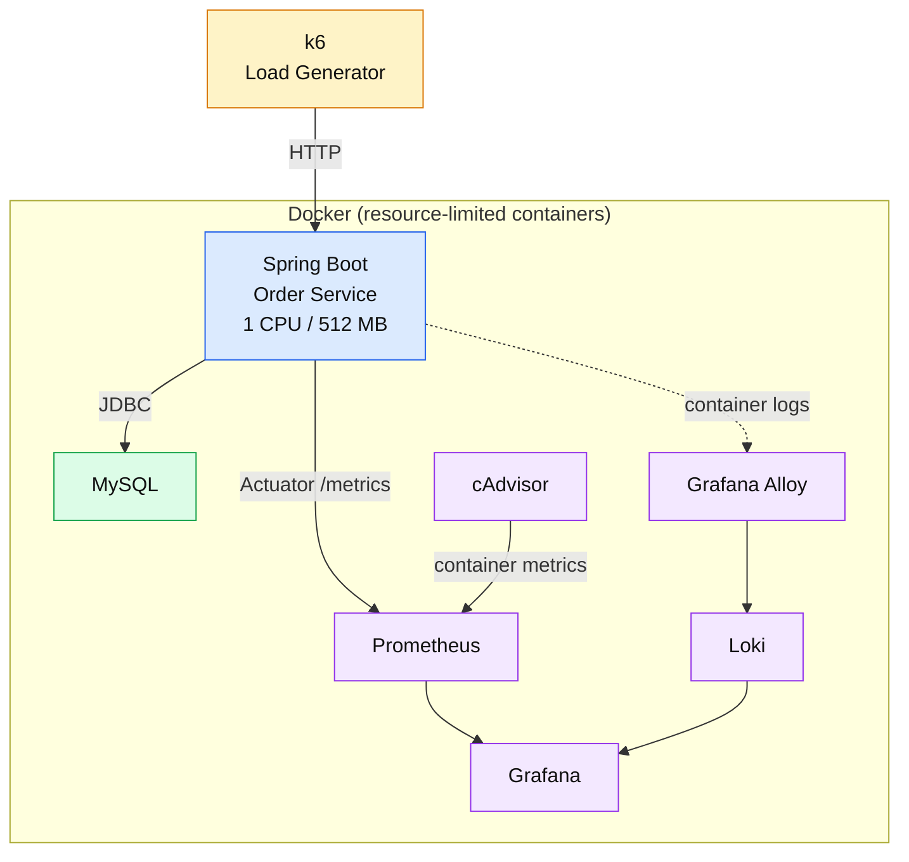
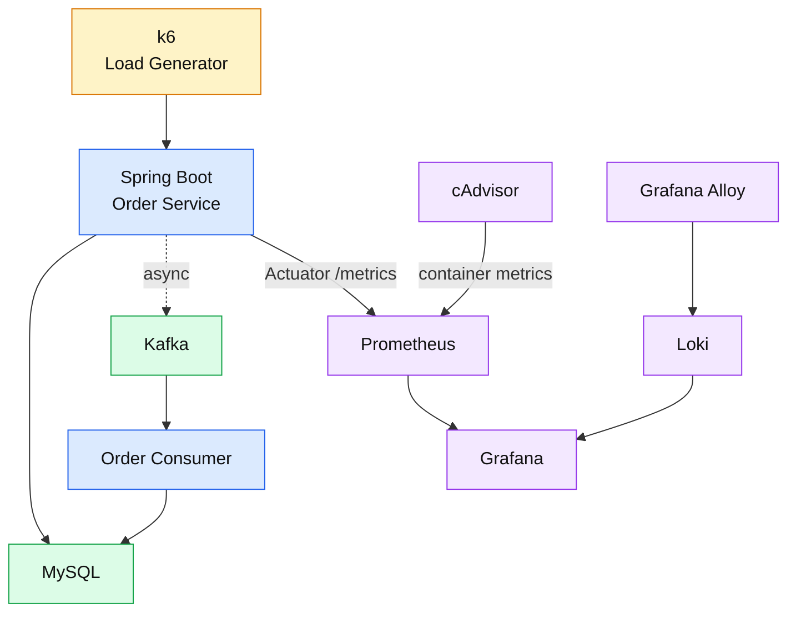

# When a Single Microservice Hits the Wall: Synchronous vs Asynchronous Processing Under Extreme Load

What actually happens when a perfectly normal Spring Boot microservice receives far more traffic than a single instance can handle?

Not theoretical traffic. Not a benchmark with `Thread.sleep()`. A real service with business logic, MySQL, transactions, Docker resource limits, Kafka, and an actual load generator.

The goal is simple:

> **Push one microservice until it starts breaking, observe exactly how it breaks, then introduce asynchronous processing and see what actually changes.**

We will deliberately create the bottleneck instead of hiding it behind Kubernetes or autoscaling. The interesting part isn't that async is "faster" — it's **where the pressure moves**.

---

## Technology stack

| Component                     | Role in the experiment                                                                                          |
| ----------------------------- | --------------------------------------------------------------------------------------------------------------- |
| Java, Spring Boot **4.1.1**, Gradle | The order service under test; Actuator + Micrometer expose its metrics in Prometheus format. ([Home][2])      |
| MySQL                         | Stores customers, products, inventory and orders; the transactional bottleneck we expect to hit.                |
| Apache Kafka                  | Message broker for the async path; buffers requests between the API and the consumer (phase 2 only).            |
| Docker / Docker Compose       | Runs every component and **provisions resources**: CPU and memory limits per container define the capacity envelope. |
| k6                            | Load generator that drives a controlled, ramping arrival rate against the API.                                  |
| Prometheus                    | Scrapes and stores time-series metrics from the service and cAdvisor.                                           |
| cAdvisor                      | Exposes per-container CPU, memory, throttling, network and restart metrics to Prometheus. ([Prometheus][3])     |
| Grafana Alloy                 | Agent that collects container logs and ships them to Loki. ([Grafana Labs][4])                                   |
| Grafana Loki                  | Log store, indexed by labels, queryable alongside metrics in Grafana.                                           |
| Grafana                       | Dashboards that put application, JVM, container, database and Kafka behaviour on one screen.                    |

Spring Boot 4.1.1 is currently listed as the latest stable Spring Boot version. ([Home][1])

---

# 1. A realistic business operation

Not `POST /hello` — that tells us almost nothing. Instead, an e-commerce **order reservation**:

```text
POST /orders/reserve
```

```json
{
  "customerId": 12345,
  "productId": 987,
  "quantity": 2
}
```

Tables: `customers`, `products`, `inventory`, `orders`, `order_items`.

```java
@Transactional
public Order reserve(ReserveRequest request) {

    validateCustomer(request.customerId());

    Inventory inventory =
        inventoryRepository.findForUpdate(request.productId());

    validateStock(inventory, request.quantity());

    inventory.reserve(request.quantity());

    Order order = createOrder(request);

    orderRepository.save(order);

    return order;
}
```

**This isn't CPU-only benchmarking.** Each request involves HTTP processing, object allocation, validation, connection acquisition, SQL, transaction management, row locking, persistence and response serialization.

### Two processing paths, one business logic

The business logic lives in a shared `OrderService` (`validate()`, `reserveInventory()`, `createOrder()`, `persist()`), exposed two ways:

```text
POST /orders/reserve-sync   →  OrderService → MySQL → 200 OK

POST /orders/reserve-async  →  validate → Kafka → 202 Accepted
                                          Kafka → OrderConsumer → OrderService → MySQL
```

We're changing the **processing model**, not the business logic — which keeps the comparison clean.

---

# 2. One instance with a known resource limit

All resources are provisioned through **Docker**: every component runs as a container, and the service under test gets explicit CPU and memory limits in Docker Compose.

```yaml
services:

  order-service:
    image: order-service
    deploy:
      resources:
        limits:
          cpus: "1.0"
          memory: 512M
```

The exact limit isn't important. What matters is that **we know the limit** — otherwise "memory reached 90%" means nothing, and without limits the experiment becomes "let's see how much my laptop can handle."

Later we can change `512 MB → 1 GB` or `1 CPU → 2 CPU`, repeat the test, and measure the effect of resources on capacity.

---

# 3. Control the arrival rate, not concurrent users

"Millions of requests" does **not** mean 1,000,000 simultaneous HTTP connections — that's a different experiment. Instead we ramp the **arrival rate**. k6's arrival-rate executors generate iterations independently of how quickly the system under test completes them. ([Grafana Labs][5])

```javascript
export const options = {
  scenarios: {
    load: {
      executor: 'ramping-arrival-rate',

      startRate: 100,
      timeUnit: '1s',

      stages: [
        { target: 250, duration: '1m' },
        { target: 500, duration: '1m' },
        { target: 1000, duration: '1m' },
        { target: 2000, duration: '1m' }
      ],

      preAllocatedVUs: 100,
      maxVUs: 1000
    }
  }
};
```

Tune the numbers to the machine running the experiment. k6 also reports request duration, errors and dropped iterations, and thresholds turn expectations into explicit pass/fail criteria. ([Grafana Labs][6])

---

# 4. What we observe

Not just requests/sec — the entire failure curve. One Grafana dashboard, four sections:

| Section        | Metrics                                                                                     |
| -------------- | ------------------------------------------------------------------------------------------- |
| Application    | Request rate, p50 / p95 / p99, 4xx / 5xx, active & rejected requests                         |
| JVM            | Heap used / max, non-heap, GC count, GC pause time, threads                                  |
| Container      | CPU %, CPU throttling, memory % / working set, network I/O, restarts                         |
| Database       | Active connections, pool usage, query latency, transactions/sec, lock waits                  |
| Kafka (async)  | Producer rate, consumer rate, consumer lag, processing latency                               |

### Phase 1 architecture: synchronous (no Kafka)

Everything runs as Docker containers, with the order service capped at 1 CPU / 512 MB.



### Phase 2 architecture: with Kafka

The same environment with the async path added:



Run the load test while watching the dashboard and you can literally see the system transition through different states.

---

# 5. Synchronous: how a service breaks

Every request waits for validation, a DB connection, SELECT, UPDATE, INSERT and COMMIT. Suppose the service sustains 500 req/s and k6 sends 1,000 req/s.

It rarely goes straight from `200 OK` to `💥 DEAD`. It degrades progressively:

```text
Load increases → CPU increases → requests take longer
  → threads stay occupied longer → connection pool busy
  → requests wait for DB connections → latency increases
  → timeouts → retries add more work
  → CPU / memory / DB pressure increases
  → 5xx errors → OOM / container kill / restart
```

### Memory exhaustion

**High memory usage does not automatically mean a memory leak.** Under load, memory grows from request objects, JSON payloads, ORM entities, JDBC buffers, queued work, thread stacks, Kafka producer buffers and temporary allocations. The JVM then spends more and more time in GC:

```text
Traffic      ████████████████████
CPU          ████████████████████
Memory       ████████████████████
GC           █████████████████
Latency      ███████████████████████
Errors       ███████████████
```

Eventually you may see an `OutOfMemoryError`, or the runtime kills the container for exceeding its memory limit. That's the moment we want to capture.

### CPU exhaustion

Memory stable (`350 MB / 512 MB`) but CPU at 100% tells a different story: the application is logically healthy, it just can't execute enough work. More work than CPU → queueing → latency → timeouts.

> **Capacity is not a single number.**

The bottleneck could be CPU, memory, threads, DB connections, database CPU, database locks, network, Kafka or disk.

---

# 6. Asynchronous: the pressure moves

With Kafka, the API validates, publishes an event and returns `202 Accepted`; a consumer does the business operation. The user-facing request no longer waits for MySQL.

Take 1,000 incoming req/s against a business/DB layer that sustains 400 ops/s:

```text
Synchronous                         Asynchronous

1000 req/s                          1000 req/s
    ↓                                   ↓
   API                                 API  (fast)
    ↓                                   ↓
  MySQL (400/s)                       Kafka ──► backlog
                                        ↓
Requests wait, latency rises,       Consumer (400/s) → MySQL
timeouts and errors increase
```

What we expect to see on the dashboard:

```text
Synchronous                         Asynchronous
CPU             ███████████████     API CPU         ███████████
Memory          █████████████       API Memory      █████████
DB connections  ███████████████     API latency     ███
Latency         ███████████████████ Kafka lag                ███████████████
Errors                  ███████████ Consumer CPU             █████████████
                                    DB load                  █████████████
```

The async API may look dramatically healthier. Stopping there is the classic mistake.

### Async does not create capacity

This is the most important takeaway of the experiment. Kafka cannot make a 400 orders/sec database process 4,000/sec. It becomes a buffer:

```text
lag growth = incoming rate − processing rate
           = 1000 − 400 = ~600 messages/sec
```

The system can look extremely healthy from the API while quietly accumulating enormous downstream work — a completely different failure mode.

### The definition of success changes

| Path  | Response         | Meaning                              |
| ----- | ---------------- | ------------------------------------ |
| Sync  | `200 OK`         | The business operation completed     |
| Async | `202 Accepted`   | The request was accepted for processing |

So async needs a status flow:

```text
POST /orders/reserve  →  202 { "requestId": "...", "status": "PROCESSING" }
GET  /orders/{id}     →  { "orderId": 12345, "status": "CONFIRMED" }   (eventually)
```

That introduces eventual consistency, retries, duplicate messages, idempotency, consumer failures, poison messages, dead-letter topics and ordering. Our tiny load test starts looking suspiciously like production — exactly what we want.

---

# 7. The experiments

| # | Experiment                     | Load                                       | Observe                                                                 |
| - | ------------------------------ | ------------------------------------------ | ----------------------------------------------------------------------- |
| 1 | Baseline                       | 100 req/s                                  | CPU, memory, latency, DB — establish normal behaviour                   |
| 2 | Push sync service              | 100 → 250 → 500 → 750 → 1000 → 1500 → 2000 | Max sustainable throughput, p95/p99, first error point, CPU / memory / DB saturation |
| 3 | Hold sync above capacity       | Sustained overload                         | Do latency, memory, GC keep rising? Pool saturation? MySQL bottleneck? Container restart? Recovery time? |
| 4 | Switch to Kafka                | Same load, same DB, same logic             | Only the processing model changes — compare                             |
| 5 | Increase async producer traffic| 500 → 1000 → 2000 → 5000 req/s             | API latency, Kafka throughput & lag, consumer and DB throughput         |

Experiment 3 is where the real story is: don't stop when errors appear. Experiment 5 shows the lesson: the API may stay fast while Kafka lag explodes.

---

# 8. What we deliberately do NOT add yet

Kubernetes, HPA, autoscaling, Redis, Elasticsearch, service mesh, API Gateway, circuit breakers everywhere, complicated tracing.

Those are the **next experiments**. First we need to understand the failure — otherwise Kubernetes simply hides the interesting part.

---

# 9. Final comparison

| Metric                   | Synchronous | Asynchronous |
| ------------------------ | ----------: | -----------: |
| API throughput           |     measure |      measure |
| API p95                  |     measure |      measure |
| API p99                  |     measure |      measure |
| Error rate               |     measure |      measure |
| CPU                      |     measure |      measure |
| Memory                   |     measure |      measure |
| DB throughput            |     measure |      measure |
| DB connections           |     measure |      measure |
| Kafka throughput         |           — |      measure |
| Kafka lag                |           — |      measure |
| Business completion rate |     measure |      measure |
| Time to completion       |     measure |      measure |

The numbers must come from the experiment — **don't manufacture a benchmark result.** Publishing real Grafana screenshots and k6 results is what turns this from another generic "sync vs async" article into an engineering investigation.

---

# Conclusion: the real lesson

The experiment isn't really about synchronous vs asynchronous. It's about **where the system absorbs excess demand**.

```text
Synchronous:   Excess demand → Threads → Connection pools → Latency → Timeouts → Errors
Asynchronous:  Excess demand → Kafka → Consumer backlog → Consumer lag
```

A microservice doesn't suddenly become unhealthy when CPU reaches 100% — the interesting part happens **before** that, as pressure propagates from traffic through threads, CPU/memory, the connection pool and the database into latency, timeouts and failure.

Kafka can decouple the HTTP request from expensive downstream processing and absorb bursts, but it doesn't eliminate the underlying capacity constraint. If consumers process 500 messages/sec and producers generate 2,000, the remaining 1,500/sec don't disappear — they become **lag**. Neither architecture makes an undersized database infinitely scalable; they create different failure boundaries.

Once we know exactly where the single instance breaks, the next question becomes:

> **What do we actually do when the system reaches its limit?**

That's where the next part begins:

```text
Single instance → Multiple instances → Load balancing → Kafka consumer scaling
  → Database bottlenecks → Container orchestration → Kubernetes
  → Horizontal Pod Autoscaling → Real production architecture
```

The goal isn't to make the system survive an arbitrary number of requests. The goal is to understand **why it stops surviving, where it stops, and what engineering lever actually fixes that particular bottleneck.**

---

### Suggested Medium title

**What Really Happens When a Spring Boot Microservice Hits Its Limits? | Sync vs Async Under Extreme Load**

Alternative SEO-focused title:

**I Pushed a Spring Boot Microservice Until It Broke — CPU, Memory, MySQL, Kafka & k6**

### SEO keywords

`Spring Boot performance, Spring Boot load testing, microservices scalability, k6 load testing, Kafka asynchronous processing, synchronous vs asynchronous microservices, Java performance, JVM memory, CPU saturation, MySQL performance, Kafka consumer lag, Docker resource limits, Grafana monitoring, Prometheus, Loki, microservices performance testing`

[1]: https://docs.spring.io/spring-boot/4.0/reference/index.html "Reference :: Spring Boot"
[2]: https://docs.spring.io/spring-boot/reference/actuator/metrics.html "Metrics :: Spring Boot"
[3]: https://prometheus.io/docs/guides/cadvisor/ "Monitoring Docker container metrics using cAdvisor | Prometheus"
[4]: https://grafana.com/docs/loki/latest/send-data/alloy/ "Ingesting logs to Loki using Alloy | Grafana Loki documentation"
[5]: https://grafana.com/docs/k6/latest/testing-guides/api-load-testing/ "API load testing | Grafana k6 documentation"
[6]: https://grafana.com/docs/k6/latest/using-k6/thresholds/ "Thresholds | Grafana k6 documentation"
